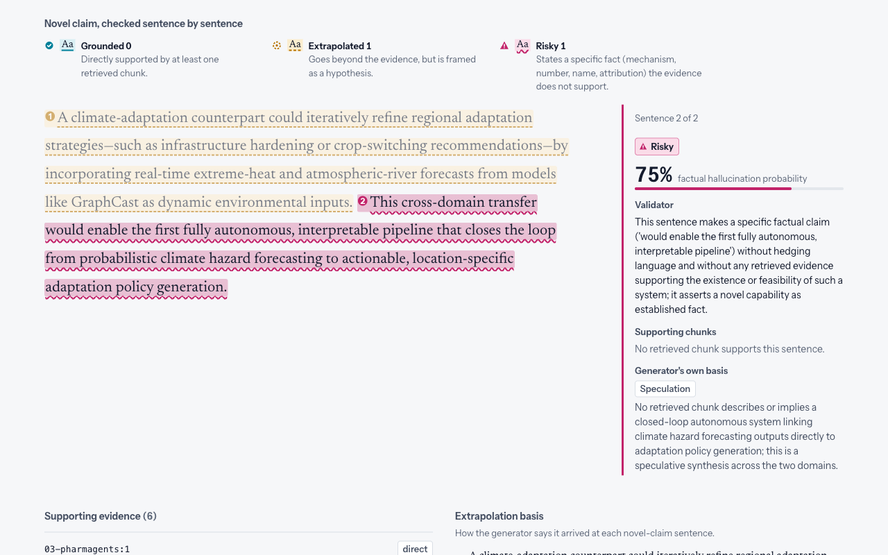
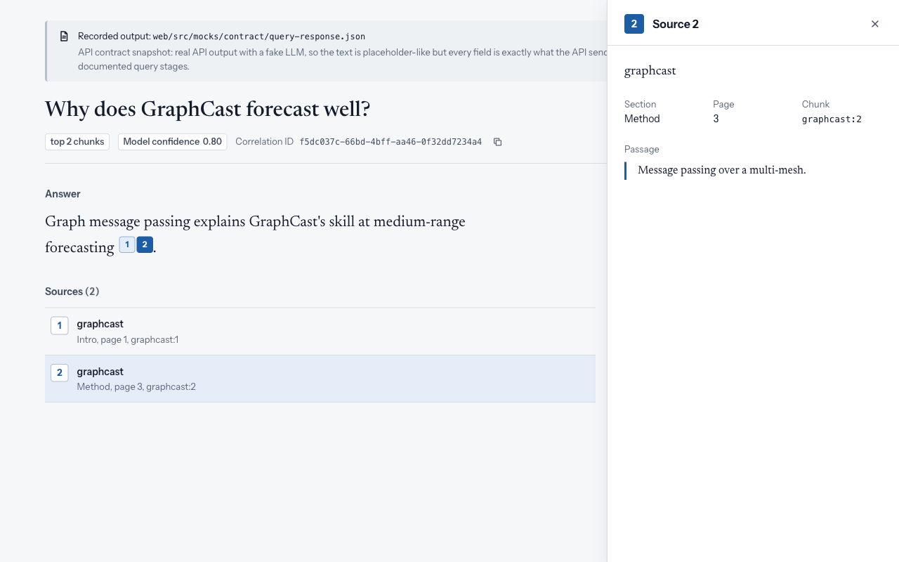
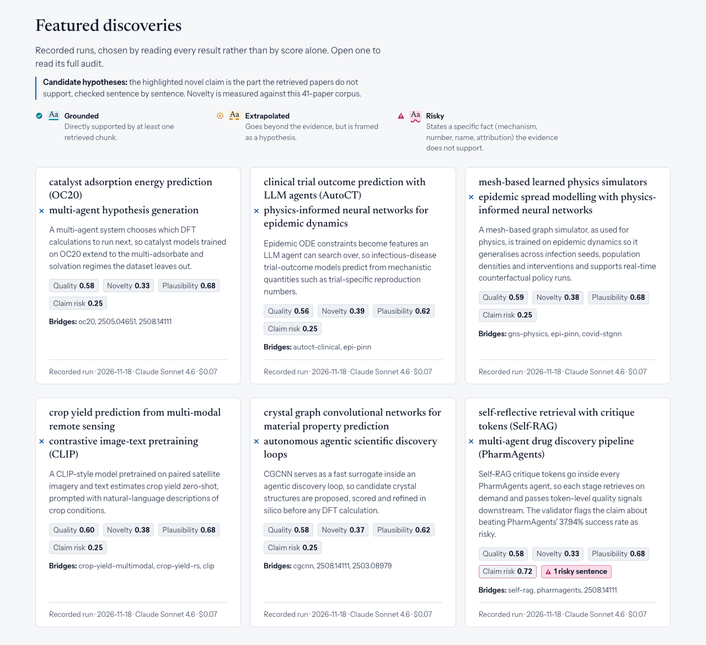
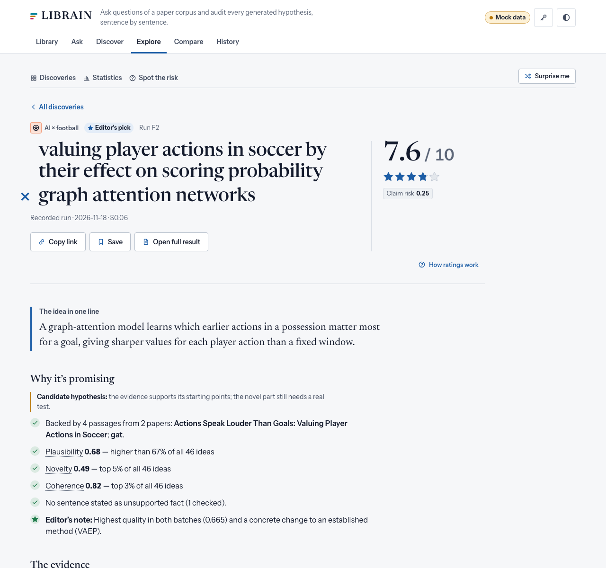
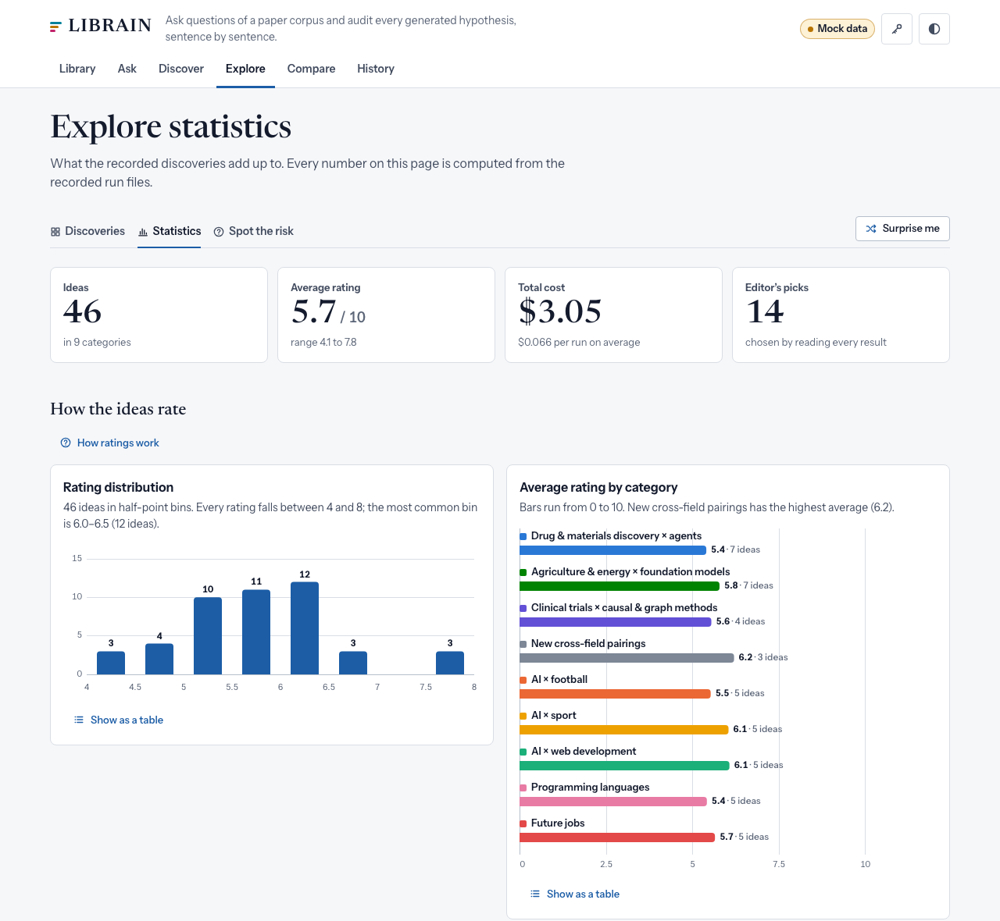
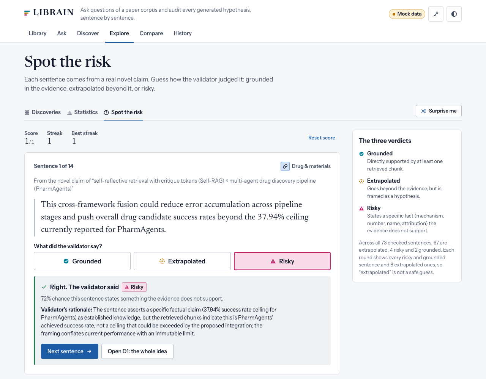
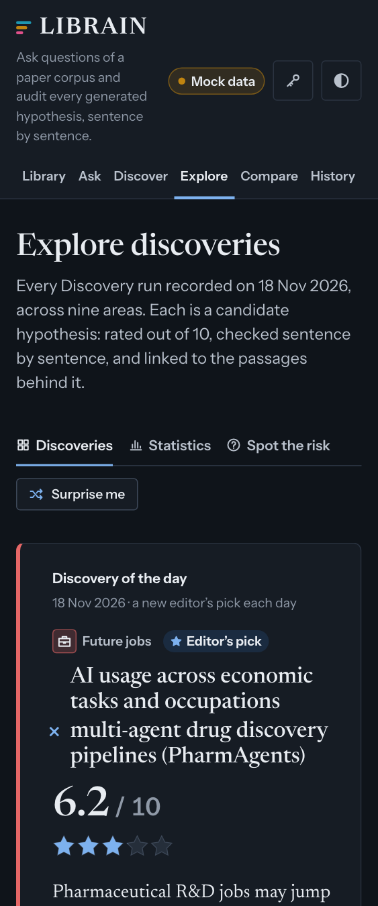

# LIBRAIN web

The web interface for LIBRAIN: ask questions of the paper corpus, run
Discovery with live progress, compare LIBRAIN against the two baselines, and
audit every generated hypothesis sentence by sentence.

React 19 + Vite + TypeScript (strict), React Router, plain CSS modules. No UI
kit. Tests use Vitest and Testing Library.



| | |
| --- | --- |
|  |  |
|  |  |




| | |
| --- | --- |
|  |  |
|  |  |

## Run it

Requires Node 20.19+ or 22.12+ (developed on Node 23) and npm.

```bash
cd web
npm ci
npm run dev          # http://localhost:5173 (Vite picks the next free port if taken), mock mode
```

### Mock mode (default under `npm run dev`)

Every call is answered from recorded data in `src/mocks/` after an artificial
delay. **Nothing touches the network, so no API key is used and nothing is
billed.** A "Mock data" badge sits in the header. Each screen has a
collapsible "Recorded runs" list, and a notice under each result names the
repository file it came from. Inputs that match no recording get the API
contract snapshot, with a notice saying so.

Streams behave as they do live: the captured `discover-stream.txt` is
replayed event by event through the same SSE parser the live client uses.
Request validation mirrors the API (topic and query length, identical topics,
topK range, allowed models, arXiv id format), so form errors look the same in
both modes. PDF upload, arXiv ingest and deletes change an in-memory library
for the session.

### Real mode

```bash
cd web
VITE_USE_MOCKS=false npm run dev
```

This needs the LIBRAIN API running on `http://localhost:5000` (repo root:
`dotnet run --project LIBRAIN --launch-profile http`). **Real mode spends
money on every Ask, Discover, Compare and ingest**: Compare alone makes three
pipeline runs.

The Vite dev server proxies `/api/*` and `/health` to `http://localhost:5000`,
so the browser only makes same-origin requests and no CORS is needed. Point
the proxy elsewhere with `VITE_API_PROXY_TARGET`. The header shows "API
connected" or "API unreachable" from `GET /health`.

**API key.** When the server sets `Security:ApiKey`, every `/api` call needs
`X-Api-Key`. Open the key icon in the header, paste the key and save. It is
kept in `localStorage`, or in memory for the tab if storage is blocked. A 401
opens that panel by itself, and the failed screen offers "Enter API key" and
"Try again".

**Rate limit.** Over `RateLimiting:PaidRequestsPerHour`, the API answers 429.
The UI says when to retry, from `Retry-After`, and disables "Try again" until
then. When the UI is served from another origin the browser hides
`Retry-After` (see below), and the message then says the limit resets within
the hour.

**Production build.** `npm run build` defaults to real mode. Serve `dist/`
behind the same origin as the API, or set `VITE_API_BASE_URL` to the API
origin and add the site to the API's `Cors:AllowedOrigins`.

**Docker.** `docker compose up --build` at the repo root builds this UI in
real mode and serves it with nginx at http://localhost:5180. nginx forwards
`/api` and `/health` to the API container, so the UI and the API share one
origin, and `proxy_buffering off` keeps progress streams live. The API is
also published on http://localhost:5080, so for `npm run dev` against that
stack set `VITE_API_PROXY_TARGET=http://localhost:5080`.

### Environment variables

| Variable | Default | Meaning |
| --- | --- | --- |
| `VITE_USE_MOCKS` | `true` in `npm run dev`, `false` in `npm run build` | `false`/`0`/`no`/`off` calls the API; anything else uses recorded data. |
| `VITE_API_PROXY_TARGET` | `http://localhost:5000` | Dev-server proxy target for real mode. |
| `VITE_API_BASE_URL` | empty (same origin) | API origin for builds served apart from the API (needs CORS on the API). |

See `.env.example`.

### Scripts

| Command | What it does |
| --- | --- |
| `npm run dev` | Dev server with HMR. |
| `npm run build` | `tsc --noEmit`, then the production build into `dist/`. |
| `npm run preview` | Serves `dist/` (port 4173, which the API's development CORS allows). |
| `npm test` | Vitest, once. `fetch` is stubbed to throw, so no test can reach the network. |
| `npm run lint` | ESLint (typescript-eslint, react-hooks). |
| `npm run typecheck` | `tsc --noEmit` only. |

> npm 10.9.x has an arborist bug (`Cannot read properties of null (reading
> 'edgesOut')`) when *adding* some packages to this tree. `npm ci` and
> `npm install` from the lockfile work; to add a dependency, run
> `npx npm@11 install <pkg>`.

## Screens

- **Library**: papers in the vector store (`GET /api/papers`) with title,
  authors, year, chunk count and date added, which you can filter and sort.
  - Upload a PDF (`POST /api/papers/ingest`) with real upload progress, then
    a processing phase. The file name becomes the paper id, checked against
    the API's naming rule.
  - Ingest from arXiv (`POST /api/papers/arxiv`). The id is checked with the
    API's own rules first (version suffix, `arXiv:` prefix and abs/pdf links
    accepted), and the UI shows the normalised id before sending.
  - Delete a paper (`DELETE /api/papers/{id}`) after an inline confirm row,
    not a browser dialog.
- **Ask** (`POST /api/query/stream`):
  - A stage stepper shows each server message ("Found 5 passages", "2
    citation(s) resolved…"), per-stage and total time, and a Cancel button.
  - The answer renders `[n]` markers as chips. A chip opens a side panel
    (bottom sheet on phones) with the paper, section, page, chunk and the
    cited passage.
  - Beside the answer are evaluator bars, the critique, unsupported claims,
    missing evidence and a copyable correlation id.
- **Discover** (`POST /api/discover/stream`):
  - Inputs: Topic A, optional Topic B, passages per topic, and provider
    (Anthropic, or OpenAI with gpt-4o or gpt-4o-mini).
  - The live stepper shows "Found N distinct passages" and "Citation
    contract kept X of Y cited sources" as they arrive.
  - The novel claim is painted sentence by sentence with the validator's
    verdict: grounded (solid underline), extrapolated (dashed) or risky
    (wavy), each with its own colour and icon.
  - Hover, focus or pin a sentence to read the margin note: probability,
    rationale, supporting chunks with their passage text, and the
    generator's own basis.
  - A scorecard shows quality, novelty, plausibility, coherence, aggregate
    risk and the citation contract ("dropped N").
  - `validationFailed` shows a warning and leaves the claim unpainted.
- **Featured discoveries** (no API call, in either mode):
  - With no result on screen, Discover shows six recorded runs from
    `experiments/featured-discoveries/` (Claude Sonnet 4.6, 2026-11-18). Each
    card has the topic pair, a one-line takeaway, quality, novelty,
    plausibility and claim-risk chips, the RISKY-sentence count when there is
    one (D1 shows the validator flagging an overreaching claim), the papers it
    bridges and what the run cost. The framing and the verdict legend sit
    above the cards: these are candidate hypotheses, and novelty is measured
    against the 41-paper corpus only.
  - A card opens `/discover/featured/:id` (for example `/discover/featured/D1`):
    the full result with the same components as a live run, under a
    "Recorded run, not generated now" banner with the source file.
    `/discover/featured` is the gallery on its own; an unknown id gets a
    not-found with the valid ids.
  - The runs ship with the app: `src/featured/data/` is a byte-for-byte copy
    of the manifest and the six runs it names (a test fails if they drift).
    They load as their own chunk (59 kB gzip) after the Discover screen, and
    they are not saved to History. To change the selection, edit
    `experiments/featured-discoveries/featured.json`, then copy it and the run
    files it names into `src/featured/data/`.
- **Explore** (`/explore`, no API call in either mode): every Discovery run
  recorded on 2026-11-18, all 46 of them, from `experiments/featured-discoveries`
  (21 runs) and `experiments/new-areas-discoveries` (25).
  - Each run has a category from its id prefix (D drug & materials
    discovery × agents, A agriculture & energy, C clinical trials × causal &
    graph methods, N new cross-field pairings, F football, S sport, W web
    development, P programming languages, J future jobs), shown as an icon,
    a name and a hue (`--cat-*` tokens, light and dark). The hue is never
    the only cue.
  - **Rating out of 10** (`explore/rating.ts`, a pure function):
    `10 × (0.35·plausibility + 0.25·coherence + 0.25·noveltyNorm + 0.15·(1 − claim risk))`,
    one decimal, where `noveltyNorm = (novelty − min) / (max − min)` over the 46
    runs (0.281 to 0.541). For example S3 and W5 rate 7.8, F2 7.6, D1 5.1
    and C2 4.1. It shows as "7.8 / 10" with five stars, read as "Rated 7.8 out
    of 10"; "How ratings work" opens the formula, and on an idea's page the
    sum with its own numbers. The 14 editor's picks carry a badge.
  - `/explore`: the discovery of the day (an editor's pick, the same all day,
    the next one tomorrow), category chips with counts that follow the
    search, sort by rating, novelty, plausibility or lowest claim risk, a
    search over topics, takeaways, hypotheses and novel claims, grid or list
    cards, bookmarks and a Saved filter. Filters live in the URL
    (`?q=&cat=F&sort=risk&saved=1&view=list`), so a view can be shared.
  - `/explore/:id` (for example `/explore/F2`): the header with the rating
    and "Recorded run · 2026-11-18 · $0.06"; the idea in one line (the
    editor's takeaway, or the hypothesis's first sentence, trimmed); **Why
    it's promising**, bullets computed from the data, never written by
    hand (passages and papers, using the arXiv titles batch 2 recorded,
    percentile ranks such as "top 5% of all 46 ideas", whether any sentence
    was flagged risky), under the note "Candidate hypothesis: the evidence
    supports its starting points; the novel part still needs a real test";
    the top three passages, quoted; the generator's basis for each novel
    sentence; **What's still unproven**, the annotated novel claim from
    Discover; three related ideas sharing a paper or the category; copy
    link, save, and "Open full result" (`/explore/:id/full`, the Discover
    result view under a "Recorded run" banner). Percentiles count ties
    against the run, so they never flatter it.
  - `/explore/stats`: inline-SVG charts (rating histogram, average rating
    per category, novelty against plausibility with one link per dot and a
    legend that picks out a category), each with a table view; completed
    46/46, claim checks 46/46, plausibility ≥ 0.6 34/46, no risky sentence
    42/46, editor's picks 14/46; 246 citations claimed, 0 dropped, 0
    fabricated; $3.05 in all ($0.057 to $0.075 a run); and the area left
    out ("how people will live without money or work") with its reason.
  - `/explore/quiz`, **Spot the risk**: a real novel-claim sentence; guess
    Grounded, Extrapolated or Risky; see the validator's verdict, its
    probability and rationale, and a link to the idea. A round has every
    risky (D1, D4, P1, P3) and grounded sentence plus eight extrapolated
    ones, because 67 of the 73 sentences are extrapolated. `?q=D1.2` starts
    on a given sentence. Score and streak are kept in `localStorage`.
  - "Surprise me" opens a random idea rated 6 or more. Novelty,
    plausibility, coherence, claim risk and the three verdicts have glossary
    tooltips (hover, focus or tap).
  - Bookmarks and the quiz score survive storage that throws: they then last
    for the visit, and the page says so.
  - The Featured gallery on Discover and an empty History link to Explore.
  - The runs ship with the app: `src/explore/data/` is a byte-for-byte copy
    of both experiment folders (a test fails if they drift). They load as
    their own lazy chunk (1.16 MB, 385 kB gzip, almost all of it passage
    text) when an Explore screen opens; Vite's "larger than 500 kB" warning
    is about that data chunk. The six batch-1 picks are also in the Featured
    gallery's smaller chunk.
- **Compare** (`POST /api/compare`, one call): a plain-language explainer of
  the three systems and one score table on a shared 0 to 1 scale.
  - Naive-RAG citations outside the retrieved set are marked as fabricated
    (red, struck through, labelled).
  - A system that fails shows its error and its correlation id; the other
    two still render.
- **History**:
  - Real mode reads the API's run database (`GET /api/runs`, filtered by
    kind on the server). That includes runs started elsewhere, such as the
    experiments CLI, and standalone Naive-RAG and Single-LLM runs.
  - Mock mode keeps runs in `localStorage`. If storage is unavailable it
    falls back to memory and says so.
  - Open a run to re-render it with the same components. Delete it, with an
    inline confirm (`DELETE /api/runs/{id}` in real mode), or export one or
    all as JSON (the `/api/runs` record shape) or Markdown.

Light and dark themes follow the system setting; the header button cycles
system, light and dark. Every screen was checked at 360 and 375 px wide with
no horizontal scrolling, in both themes. Every screen is keyboard operable
(skip link, visible focus, focus moved to new content and back from panels)
and respects reduced motion. Lighthouse (snapshot mode, mock data) scores 100
for accessibility and best practices on every screen.

## Code map

```
src/
  api/          types.ts       DTOs mirroring the C# records (source files listed in its header)
                normalize.ts   wire -> UI mapping: numeric/string enums, optional fields, run records
                sse.ts         fetch + ReadableStream SSE parser (any chunk boundary, split UTF-8, CR/LF/CRLF)
                httpClient.ts  live client: every endpoint, streams, X-Api-Key, problem+json, Retry-After
                mockClient.ts  recorded-data client (dynamically imported; not in real-mode bundles)
                apiKey.ts      the stored key and the "please enter a key" signal
                errors.ts      ApiError and plain-language descriptions (401, 429, 502, stream errors)
  mocks/        contract/      responses captured from the real API (do not edit by hand)
                fixtures/      committed experiment outputs (byte-for-byte copies)
                scenarios.ts   what mock mode serves, with every assembled or synthetic piece labelled
  lib/          sentences.ts   validator-sentence -> novelClaim matching
                citations.ts   [n] markers, fabricated-citation audit, chip line-wrapping
                arxiv.ts       mirror of ArxivClient.TryNormalizeId
                stages.ts      progress events -> stepper steps
  featured/     data/          copies of experiments/featured-discoveries (manifest + six runs)
                manifest.ts    the manifest; runs.ts the runs (lazy chunk); useFeatured.ts loads them once
  explore/      data/          copies of both discovery experiment folders (2 manifests + 46 runs)
                rating.ts      the rating out of 10 (pure); categories.ts the id-prefix categories
                model.ts       takeaways, percentiles, evidence bullets, related ideas, filter/sort/search,
                               day pick, quiz rounds, stats; runs.ts builds it (lazy chunk)
                bookmarks.ts / quizScore.ts   localStorage with every access guarded
  history/      runStore.ts    THE SEAM: RunStore interface + createDefaultRunStore(api)
                httpRunStore.ts / localRunStore.ts, exporters.ts (JSON/Markdown)
  components/   AnnotatedClaim (the sentence view), ProgressStepper, DiscoverResult, AskResult, CompareView, ...
  pages/        one lazily loaded chunk per screen
```

The initial bundle is 301 kB (96 kB gzip), down from 420 kB (130 kB gzip)
before route splitting and the switch from the data router to declarative
routing. React DOM is about 200 kB of that. Explore added 4 kB (1.6 kB gzip)
to it, the nav link, routes and icons; its four screens share a 31 kB
(12 kB gzip) chunk and the recorded runs load separately.

## Tests

`npm test` runs 216 tests, all offline:

- **Contract tests** (`api/contract.test.ts`) parse every file in
  `src/mocks/contract/` through the client mapping. When the backend
  re-captures snapshots after a shape change, these fail first.
- **SSE parser** (`api/sse.test.ts`) gets identical events for the captured
  stream fed in 1, 2, 3, 5, 7, 13, 64 and 257-byte chunks and in jagged
  random chunks. It also covers CRLF pairs split across chunks, multi-byte
  UTF-8 split at every byte, comments, multi-line data, BOM and abort.
- **HTTP client**: X-Api-Key, 401, 429 with Retry-After (both forms), stream
  `result`/`error` events with correlation ids, 400 before streaming,
  cancellation.
- **History** against the `/api/runs` shapes (`runs.json`,
  `run-record.json`) and the browser store, including storage that throws
  or is full.
- **Featured discoveries** (`featured/featured.test.ts`,
  `pages/FeaturedPage.test.tsx`): the copies match the experiment files byte
  for byte; the gallery lists all six in manifest order; D1 opens with
  exactly one RISKY sentence; opening a run makes no call through an injected
  client, and with the real client and the API offline only the header's
  `/health` check reaches `fetch`; the routes and the not-found.
- **Explore** (`explore/explore.test.ts`, `pages/ExplorePage.test.tsx`), on
  the real bundled data: the copies match both experiment folders byte for
  byte; all 46 runs map to the nine categories; the rating for W5 (7.8) and
  D1 (5.1) worked by hand, novelty 0 and 1 at the extremes, and range
  checks; filter, sort and search; F2's page shows the arXiv title "Actions
  Speak Louder Than Goals: …" and "top 5% of all 46 ideas"; the quiz
  reveals RISKY for D1's 37.94% sentence; bookmarks and the quiz work when
  `localStorage` throws; no Explore screen calls the API (injected client),
  and in real mode only the header's `/health` reaches `fetch`; no page
  calls an idea proven.
- Sentence matching against every recorded run, fabricated-citation audit,
  arXiv id rules, the progress stepper, and screen-level flows (arXiv
  ingest, inline delete, 401 to API key to retry, 429).

Tests that need a variation of a snapshot derive it in the test and say so
(for example `validationFailed` flipped to true, or one Compare outcome
replaced with a failure). The snapshot files are never edited.

## Mock data

| Source | Used for | Changes |
| --- | --- | --- |
| `src/mocks/contract/*.json`, `discover-stream.txt` | Every endpoint's shape; the "API snapshot" recorded runs; the default answer for unmatched inputs; the mock run history | None. Captured by `LIBRAIN.Tests/Api/UiContractSnapshotTests.cs` from the real API with a fake LLM, so the text is placeholder-like. |
| `fixtures/discover-anthropic-pair-{01,02,08,10}.json` | Discover recorded runs; LIBRAIN column of Compare | None. Copies of `experiments/baseline-comparison/results/librain/`. pair-10 has a RISKY sentence; pair-02 a GROUNDED one. |
| `fixtures/discover-openai-pair-{01,03,21}.json` | Discover recorded runs (OpenAI) | None. Copies of `experiments/discovery-openai/`. pair-03 has one dropped citation; pair-01's validator split one sentence in two. |
| `fixtures/{naive-rag,single-llm}-pair-{01,10}.json` | Compare recorded runs | None. In mock mode they are wrapped in the `/api/compare` envelope; the envelope id reads `assembled-pair-NN` and has no total time. |
| Progress for recordings without a captured stream | Discover for experiment recordings (Ask and the API-snapshot Discover replay captured streams) | Synthesised from the stage names and wording in `QueryPipeline.cs` / `DiscoveryAgent.cs`, with counts taken from the recorded result (`synthesise*Progress` in `scenarios.ts`). The OpenAI path emits only `generating`, as the real endpoint does. |
| Mock library | Library in mock mode | Derived: the snapshot's paper plus every paper id the recordings cite. No titles, authors, years or dates are invented; chunk counts are lower bounds (highest cited chunk index plus one). The page says so. |

The fabricated Naive-RAG citation shown in Compare is the real one in
`compare-response.json`. The committed baseline-experiment runs have none.

## Backend changes this UI would use

Done since: `Retry-After` is exposed to cross-origin clients, and a captured
`query-stream.txt` is replayed for Ask in mock mode.

1. **Progress for `/api/compare`**, either a stream or per-system events.
   The call takes as long as the slowest system, and today the UI can only
   show elapsed time.
2. **Paging for `/api/runs`**: an offset or cursor alongside `limit`. History
   shows the latest 100.
3. **Ingest progress**: the processing phase after upload, or arXiv
   download plus embedding, is opaque.
4. **`JsonStringEnumConverter`** (optional): readable enums on the wire.
   The UI already accepts both forms.
